<p align="center"></p>

<h1 align="center">MSTR 看盘</h1>

<p align="center">在自己的 Mac 上看 MSTR（Strategy Inc）的行情、mNAV 和持币情况。<br>打开一个本机网页，K 线、比特币、走势对比和场外基金都在一页里。目前只支持 macOS。</p>

---

## 功能

想知道 MSTR 现在贵不贵、比特币在干什么、和纳指比谁涨得多，又不想开一堆网站？打开这个页面就能看到：

1. **总览**：现价在一年里的位置、mNAV、趋势、波动、比特币和市场情绪，每张卡片一句话说清楚。
2. **MSTR 和比特币 K 线**：日 K、周 K，50/100/200 日均线可以分别开关，带成交量、MACD、RSI、金叉死叉和财报日标记。旁边列出各个价位离现价多远。
3. **mNAV 和每股含币量**：现在和过去的走势，并区分 2026 年 7 月 23 日前后的不同算法。
4. **走势对比**：MSTR 和美股七姐妹、各行业龙头、纳指 100、标普 500、上证指数、沪深 300、比特币、BitMine 放在一起比涨跌。
5. **场外基金**：纳指 100 和标普 500 的 QDII 基金，按 A 类、C 类看哪些现在能买、每天能买多少，并记下状态变化的日期。
6. **定投模拟**：如果当初每月定投，现在的平均成本、盈亏和最深亏损是多少。
7. **公司动态**：财报日期，以及根据持币数变化推算的买卖比特币记录。
8. **持仓和交易计划**：填上自己的成本价和规则，内容只保存在你的浏览器里。

每个版块都可以收起，点旁边的 **?** 可以看说明。数据每分钟自动更新。

## 运行环境

- **一台 Mac**：暂不支持 Windows、Linux、iPhone 和 Android。
- **Python 3**：macOS 自带，不需要另外安装任何包。如果第一次运行时提示安装命令行开发者工具，点“安装”即可。
- **能联网**：行情和官网数据都是实时读取的。

## 安装

在 GitHub 页面点 **Code → Download ZIP** 下载并解压，或者用 Git：

```bash
git clone https://github.com/ljjjjj-dev/mstr-dashboard.git
```

想要一个双击就能打开的应用，可以在文件夹里运行一次：

```bash
cd mstr-dashboard && sh build-mac-app.sh
```

文件夹里会多出一个 `启动看盘.app`。如果 macOS 提示无法打开，右键点它，再选“打开”。

## 使用

1. 双击 `启动看盘.app`，浏览器会自动打开看盘页面。
2. 没有生成应用的话，也可以在终端里进入文件夹，运行 `python3 server.py`，再在浏览器打开 `http://127.0.0.1:8765`。这种方式要一直开着终端窗口。
3. 页面只在你自己的电脑上能打开，别的设备访问不到。
4. 用应用启动时，程序在后台运行，连续 12 小时没人打开页面就会自动退出，下次再双击一次就好。

成本价和交易计划保存在当前浏览器里，换浏览器或清除浏览器数据后会丢失。交易计划的提醒要页面开着、电脑没有睡眠时才有效。

### 页面上的名词

| 名词 | 意思 |
|---|---|
| K 线 | 一段时间的开盘、收盘、最高和最低价。这里收盘高于开盘是红色，低于开盘是绿色 |
| 均线 | 过去一段时间收盘价的平均 |
| mNAV | 按 Strategy 现行说明，是股价和每股净持币价值的比值。2026 年 7 月 23 日前后的定义不同，不能直接比较 |
| 每股含币量 | 每一股对应多少比特币。公司买币会让它上升，增发股票会让它下降 |
| RSI | 衡量近期涨跌力度，0 到 100 |
| 金叉 / 死叉 | 短期均线上穿或下穿长期均线，这类信号是滞后的 |
| VIX | 反映美股预期波动的指数 |
| Beta | 比特币涨跌 1% 时，MSTR 平均涨跌多少 |

## 工作原理

`server.py` 在你的电脑上开一个只有本机能访问的小服务，替页面去读各个公开接口（Strategy API 就是 Strategy 官网自己用的数据接口），再把结果交给网页显示。仓库里不保存、也不分发这些数据。

```
页面 ─▶ server.py ─▶ Yahoo Finance        股价、指数、比特币、VIX
                  ─▶ Strategy API         mNAV、持币数、市值、历史数据
                  ─▶ Nasdaq               财报日期
                  ─▶ GlobalAssetHistory   场外基金申购状态（整理自东方财富）
```

这些接口没有承诺一直开放，可能会变或失效，使用时请自己确认符合各数据源的条款。某个接口暂时取不到时，页面会继续显示上一次的数据，不会用 0 代替。

## 文件夹结构

```
mstr-dashboard/
├── server.py           本地服务：提供页面、转发数据，只监听本机
├── build-mac-app.sh    生成双击启动的 启动看盘.app
├── web/
│   ├── index.html      页面
│   ├── calc.js         均线、RSI、定投等计算
│   └── lightweight-charts.js   图表库
├── tests/              自动测试
├── docs/               应用图标和第三方许可证声明
└── data/               程序自己记录的场外基金状态，不在仓库里
```

改了代码可以跑一下测试：

```bash
node --test tests/calc.test.js && python3 -m unittest discover tests
```

## 常见问题

- **页面显示“连接中断”**：检查网络，再确认程序还在运行。程序如果已经自动退出，重新双击 `启动看盘.app` 就好。
- **终端显示 `Address already in use`**：程序已经在运行了，直接打开 `http://127.0.0.1:8765`。
- **买卖记录的日期和公告对不上**：记录是根据官网每日持币数的变化推算的，日期可能差几天，相邻两笔也可能被合并。准确的成本请看 [Strategy 官网账本](https://www.strategy.com/ledger)。
- **场外基金的“从哪天开始”是空的**：公开数据里没有官方开放日期，是程序从第一次运行起自己记录状态变化，所以要等状态变过一次才有日期。
- **想卸载**：关掉程序，删掉整个文件夹即可。

## 声明

- 本项目只是一个**个人学习用**的看盘工具，和 Strategy、Yahoo、Nasdaq 没有关联。
- 页面上的数字只是展示和历史计算，**不构成投资建议**，不提供买卖判断，也不预测涨跌。定投模拟和规则回看都是过去的结果，不代表以后。
- 数据可能有延迟或错误，只有日线和周线，没有分钟线。下单前请以券商行情为准。程序不连接券商，也不会下单。
- 图表库 [Lightweight Charts](https://github.com/tradingview/lightweight-charts) 遵循 Apache-2.0 许可证，详见 [docs/THIRD_PARTY_NOTICES.md](docs/THIRD_PARTY_NOTICES.md)。

## 许可证

[MIT](LICENSE)
