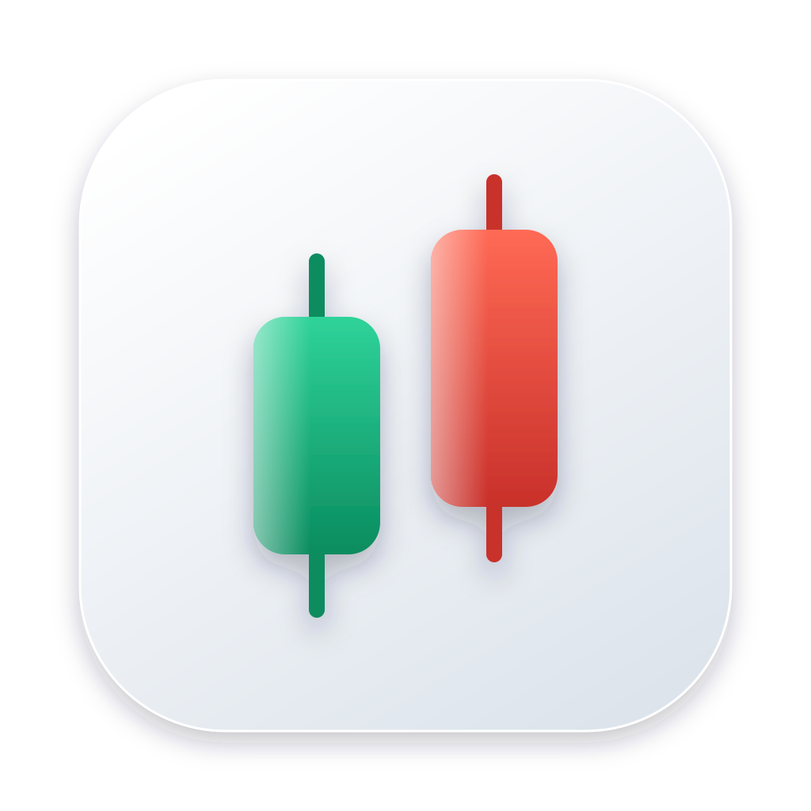
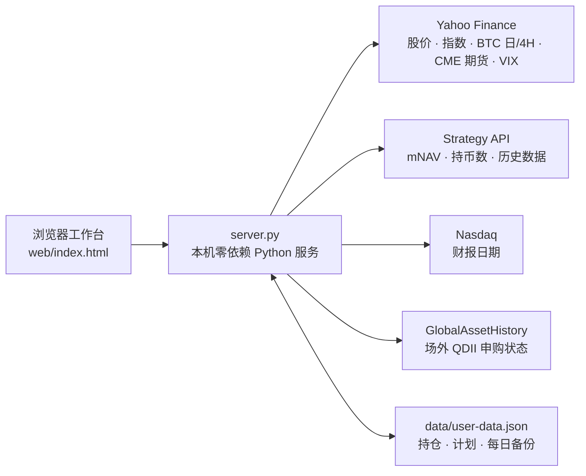

<p align="center">
  
</p>

<h1 align="center">mstr-dashboard</h1>

<p align="center">
  在自己的 Mac 上本地查看 MSTR（Strategy Inc）的行情、mNAV、持币结构与多资产对照。<br>
  融合极简高对比设计，不依赖 Python 本机运行，六个工作台一站看全。
</p>

<p align="center">
  <a href="https://github.com/ljjjjj-dev/mstr-dashboard/actions/workflows/test.yml"></a>
  <a href="LICENSE"></a>
  
  
  
</p>

<p align="center">
  <a href="#功能">功能</a> •
  <a href="#安装">安装</a> •
  <a href="#使用">使用</a> •
  <a href="#工作原理">工作原理</a> •
  <a href="#目录结构">目录结构</a> •
  <a href="#常见问题">常见问题</a>
</p>

---

## 功能

想知道 MSTR 现在贵不贵、比特币在干什么、和纳指比谁涨得多，又不想开一堆网站？打开这个本机工作台，左侧导航直达六个视图：

1. **总览看板**：MSTR 现价、盘前/盘后行情、北京时间交易时段进度条、8 格紧凑核心指标（官网 mNAV、52 周分位、均线趋势、RSI、日均波动与 Beta、情绪与 VIX、BTC 联动、200 周均线偏离）、**BTC 盘面常用指标常驻文字解读**，以及可按偏多/偏空/中性筛选的技术信号和历史金叉死叉。
2. **K 线行情**：支持 MSTR K 线、比特币 K 线与双图同屏对照。MSTR 支持日 K / 周 K、均线开关、MACD / RSI 联动副图与持仓成本参考线；**BTC 支持 `4H` / `日 K` / `周 K` 多周期切换**，内置 **Vegas 维加斯隧道（EMA 144/169）、`0.618–0.66` 黄金口袋、盘整区筹码 `POC / VAH / VAL`、前高前低止损流动性与 2B 假突破（破底翻）标记、周/月开盘价与未回补 CME 期货缺口**独立图层开关及完整文字解盘。
3. **估值与持币**：mNAV 现行算法与 2020 年起历史走势（含 2026 年 7 月 23 日改定义节点）、每股含币量（BPS）走势、公司持币与资本结构、Nasdaq 财报日与推算买卖比特币记录。
4. **持仓与交易计划**：填写自己的成本价与股数（K 线图自动画成本参考虚线），测算极端回撤压力，设定价格 / 回撤 / 200 日线 / mNAV / 复盘日期条件并支持历史回看、实盘交易日志和 6 项计划体检。
5. **对比与定投**：MSTR 与美股七姐妹、各行业龙头、纳指 100、标普 500、上证指数、沪深 300、比特币、BitMine 同屏比累计涨跌，支持快捷预设分组与定投历史模拟。
6. **场外基金 QDII**：纳指 100 和标普 500 场外 QDII 基金，支持 A/C 类、只看能买、指数筛选与实时搜索，自动记录申购状态变化日期。

### 页面上的名词

| 名词 | 意思 |
|---|---|
| K 线 | 一段时间的开盘、收盘、最高和最低价。这里收盘高于开盘是红色，低于开盘是绿色 |
| 均线 | 过去一段时间收盘价的平均 |
| mNAV | 按 Strategy 现行说明，是股价和每股净持币价值的比值。2026 年 7 月 23 日前后的定义不同，不能直接比较 |
| 每股含币量 | 每一股对应多少比特币。公司买币会让它上升，增发股票会让它下降 |
| RSI | 衡量近期涨跌力度，0 到 100 |
| 金叉 / 死叉 | 短期均线上穿或下穿长期均线，这类信号是滞后的 |
| VIX | 反映美股预期波动的指数 |
| Beta | 比特币涨跌 1% 时，MSTR 平均涨跌多少 |
| 0.618–0.66 黄金口袋 | 波段高低点斐波那契回调或反弹的高频共振区间 |
| POC / VAH / VAL | 盘整区间内成交量最密集的控制点（POC）与 70% 价值区上下沿 |
| Vegas 隧道 | EMA 144 / 169 组成的动态趋势支撑阻力带（配合 EMA 12 过滤线） |
| 2B 假突破 / CME 缺口 | 刺破波段前高/前低止损流动性后收回的价格行为，以及 CME 比特币期货周末跳空未回补缺口 |

## 运行环境

- **一台 Mac**（Apple Silicon / Intel 均可）：目前仅支持 macOS，暂不支持 Windows、Linux 与移动端。
- **Python 3**：macOS 自带标准库即可运行。若首次运行提示安装命令行开发者工具，点击「安装」即可。
- **可联网**：行情、持币与场外基金状态均为本机实时拉取。

> [!TIP]
> 无需安装任何第三方 Python 包、Homebrew 或 Node.js，克隆仓库后即可直接启动；只有在修改代码后运行前端单元测试时才需要 Node.js。

## 安装

在 GitHub 页面点击 **Code → Download ZIP** 下载并解压，或使用 Git 克隆：

```bash
git clone https://github.com/ljjjjj-dev/mstr-dashboard.git
cd mstr-dashboard
```

想要一个双击即可打开的 macOS 应用，在项目目录运行一次：

```bash
sh build-mac-app.sh
```

当前目录会生成 `启动看盘.app`。如果 macOS 提示无法打开，右键点击应用并选择「打开」即可。

## 使用

1. 双击 `启动看盘.app`，浏览器会自动打开看盘页面。
2. 也可以不打包，直接在终端运行 `python3 server.py`，然后在浏览器访问 `http://127.0.0.1:8765`（此方式需保持终端窗口开启）。
3. 服务仅监听本机 `127.0.0.1`，外部设备无法访问；页面数据每 60 秒自动刷新，点击指标旁的 **?** 可查看白话解释。
4. 通过 `.app` 启动时服务在后台运行，连续 12 小时无人打开页面会自动退出，下次直接再双击即可。

> [!NOTE]
> 支持默认高对比浅色模式与一键热切换深色模式、**一键隐私打码**（隐藏个人持仓金额与股数）。个人持仓、交易计划与界面偏好会同步保存在本机 `data/user-data.json`（每日自动备份到 `data/backups/`），也可随时在右上角「备份/状态」菜单导出或导入 `.json` 备份文件。

## 工作原理

`server.py` 在你的电脑上启动一个仅本机可访问的零依赖服务，替前端页面请求公开接口（Strategy API 即 Strategy 官网公开数据接口），并将个人配置与备份保存在本机 `data/` 目录；仓库本身不保存也不分发任何行情或个人数据。



这些公开接口并未承诺永久不变，使用时请自行确认符合各数据源条款。某个接口临时取不到时，页面会保留上一次成功的数据，不会用 `0` 覆盖。

## 目录结构

```text
mstr-dashboard/
├── server.py                   本机零依赖服务：静态页面、接口代理与本地配置存储
├── build-mac-app.sh            一键生成双击启动的 启动看盘.app
├── web/
│   ├── index.html              六个工作台主页面
│   ├── styles.css              极简高对比视觉样式（浅色 / 深色主题）
│   ├── calc.js                 均线、RSI、定投、规则回测等纯函数计算
│   ├── lightweight-charts.js   K 线与折线图表库
│   ├── icon.svg / icon.png     页面图标与 PWA 清单图标
│   ├── manifest.webmanifest    应用清单
│   └── app/
│       ├── store.js            本地 JSON 持久化与备份导入导出
│       ├── charts.js           图表生命周期、联动与主题切换
│       └── main.js             60s 行情轮询与六个工作台交互
├── tests/                      前端计算与后端服务单元测试
├── docs/                       应用图标与第三方许可证声明
└── data/                       本机记录的场外基金状态与个人备份（已 gitignore）
```

修改代码后可运行全套本地测试：

```bash
node --test tests/calc.test.js && python3 -m unittest discover tests
```

## 常见问题

- **页面显示「连接中断」**：先检查网络，再确认本机服务仍在运行；若已自动退出，重新双击 `启动看盘.app` 即可。
- **终端显示 `Address already in use`**：说明服务已在运行，直接打开 `http://127.0.0.1:8765`。
- **买卖记录的日期与公告对不上**：记录是根据官网每日持币数变化推算的，日期可能相差数天，相邻两笔也可能合并。精确成本请参考 [Strategy 官网账本](https://www.strategy.com/ledger)。
- **场外基金的「从哪天开始」为空**：公开数据不含官方开放日期，程序从首次运行起本地记录状态变更，需待状态变化后才会显示日期。
- **想卸载**：关闭后台程序，直接删除整个文件夹即可，无任何系统残留。

## 声明

- 本项目仅用于**个人学习与研究**，与 Strategy、Yahoo、Nasdaq 无任何关联。
- 页面数字仅作信息展示与历史计算，**不构成任何投资建议**，不提供买卖判断，也不预测涨跌；定投模拟与规则回看均为历史结果，不代表未来表现。
- 数据可能存在延迟或误差（MSTR 提供日线/周线，BTC 提供 4H/日线/周线）；下单前请以券商或交易平台实时行情为准，本程序不连接券商也不会执行任何交易。
- 图表库 [Lightweight Charts](https://github.com/tradingview/lightweight-charts) 遵循 Apache-2.0 许可证，详见 [docs/THIRD_PARTY_NOTICES.md](docs/THIRD_PARTY_NOTICES.md)。

## 维护与致谢

- 初始架构与核心计算由 **Claude Code** 协助构建。
- 2026-11-23 起由 **Antigravity** 接手重构与迭代，陆续升级：极简紧凑六工作台界面、BTC 多周期（4H/日/周）结构与量价指标常驻文字解盘（2B 假突破、0.618–0.66 黄金口袋、POC/VAH/VAL、Vegas 隧道、CME 缺口）、浅色/深色主题热切换、一键隐私打码以及本机 `data/user-data.json` 持久化与每日自动备份。

## 许可证

[MIT](LICENSE)
