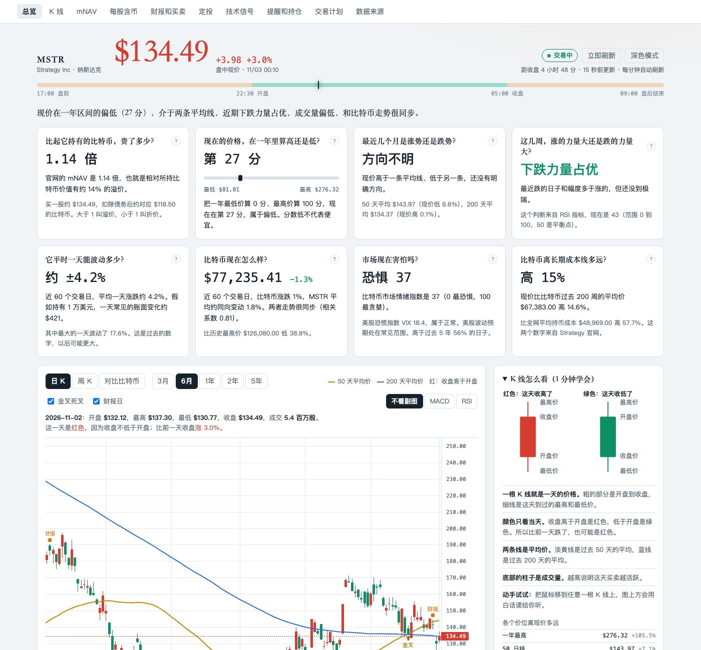

# MSTR 看盘：给新手的白话看盘工具

不会看 K 线、不懂指标也没关系。打开这个页面，它会用大白话告诉你 MSTR（Strategy 公司的股票）现在是什么情况。



> **请先看这句话：这不是投资建议。** 这个工具只告诉你“现在是什么情况”，不会告诉你该买还是该卖，也不能预测涨跌。投资可能亏损，决定请自己负责。本项目是个人学习作品，和 Strategy、Yahoo、Nasdaq 都没有关系。

## 它能帮你做什么

| 你想知道 | 页面怎么告诉你 |
|---|---|
| 现在的价格算高还是低？ | 把一年最低价算 0 分、最高价算 100 分，看现在多少分 |
| 最近是涨势还是跌势？ | 直接告诉你“偏涨势”或“偏跌势”，并说明原因 |
| 比起它持有的比特币，贵了多少？ | 显示 mNAV，还能看它过去的走势线 |
| 公司增发后，每股还对应多少比特币？ | 显示每股含币量的走势，以及持币和股数各变了多少 |
| 平时一天能波动多少？ | 例如持有 1 万美元，一天常见的账面变化有多大 |
| 市场现在害怕吗？ | 显示比特币情绪指数和美股恐慌指数 VIX |
| 我看不懂 K 线怎么办？ | 页面带图解，鼠标移到 K 线上还会用白话读出来 |
| 如果当初定投，现在怎么样？ | 用历史价格算出平均成本、盈亏和中途最多亏过多少 |
| 比特币涨 1%，MSTR 通常动多少？ | 显示最近 60 个交易日的实际变动倍数 |
| 涨到或跌到某个价时提醒我 | 弹窗、提示音和 Mac 通知 |
| 怎么防止大跌时乱操作？ | “我的交易计划”：提前写下自己的规则，到时提醒你，并能回看规则过去触发的情况 |

## 安装和打开（只需要做一次）

**你需要：** 一台 Mac，能上网。不需要注册账号，也不用懂代码。

### 第 1 步：下载

1. 在这个页面上方找到绿色的 **Code** 按钮，点一下。
2. 点 **Download ZIP**。
3. 打开“下载”文件夹，双击下载的 ZIP 文件，会解压出一个叫 `mstr-dashboard-main` 的文件夹。

### 第 2 步：打开“终端”

按 `Command + 空格`，输入“终端”或 `Terminal`，再按回车。

“终端”是 Mac 自带的工具，会出现一个可以输入文字的窗口。下面的命令可以直接复制粘贴。

### 第 3 步：进入文件夹并启动

粘贴下面这行，按回车：

```bash
cd ~/Downloads/mstr-dashboard-main
```

再粘贴下面这行，按回车：

```bash
python3 server.py
```

看到“MSTR 看盘已启动”就成功了。**这个窗口不要关**，关掉工具就停了。

> 如果 Mac 弹窗提示要安装“命令行开发者工具”，点**安装**，装好后再运行一次上面这行命令。

### 第 4 步：打开页面

在浏览器地址栏输入下面这个地址，按回车：

```
http://127.0.0.1:8765
```

完成了！这个地址只在你自己的电脑上有效，别人访问不到。

### 想以后双击就能打开？（可选）

在第 3 步的文件夹里，运行一次下面这行，文件夹里就会多一个 `启动看盘.app`：

```bash
sh build-mac-app.sh
```

以后双击它，页面就会自动打开，不用再操作终端。如果 Mac 提示无法打开，就右键点它，选择“打开”。可以把它拖到程序坞，用起来更方便。

## 怎么用

- **看行情：** 打开后数据每分钟自动更新，什么都不用点。
- **看解释：** 看不懂时，点每一项旁边的 **?**。
- **设提醒：** 在“到价提醒”里选择“涨到或高于”或“跌到或低于”，填上价格，点“添加”。页面要一直开着才会提醒。
- **记成本：** 在“我的持仓”里填成本价，可以看到盈亏。这些数字只保存在你的浏览器里，不会上传。
- **写计划：** 在“我的交易计划”写下买入理由和规则。规则和数字都由你决定，工具只提醒，不下单。
- **换颜色：** 点右上角的“深色模式”。

## 这些词是什么意思

| 词 | 通俗解释 |
|---|---|
| **MSTR** | Strategy 公司的股票代码，这家公司持有大量比特币 |
| **K 线** | 用一根“蜡烛”表示一天的开盘、收盘、最高和最低价 |
| **红色 / 绿色** | 这里是中国习惯：收盘高于开盘是红色，低于开盘是绿色 |
| **均线** | 过去一段时间的平均价格，比如 50 日均线就是过去 50 天的平均价 |
| **mNAV** | 股价比每股净持币价值贵多少，大于 1 叫溢价，小于 1 叫折价。官网在 2026 年 7 月 23 日改过定义，前后不能直接比 |
| **每股含币量** | 每一股对应多少比特币。买币会让它上升，增发会让它下降 |
| **RSI** | 衡量最近涨跌力量的指标，范围 0 到 100 |
| **金叉 / 死叉** | 短期均线上穿长期均线叫金叉，下穿叫死叉。它们总是滞后的 |
| **VIX** | 美股恐慌指数，数字越高，代表市场预期波动越大 |
| **Beta（变动倍数）** | 比特币变动 1% 时，MSTR 平均变动多少 |
| **定投** | 不管涨跌，定期投入固定金额 |

## 常见问题

**要花钱吗？** 不用，工具免费，也不需要注册。

**能帮我买卖股票吗？** 不能。它只负责看，不连接任何券商，也碰不到你的账户。

**iPhone 或 Windows 能用吗？** 目前只在 Mac 上测试过。手机上想收提醒，建议用券商 App。

**数据准吗？** 数据可能有延迟，也可能偶尔出错。下单前一定要以券商显示的行情为准。

**怎么知道数据有没有问题？** 看页面底部的“数据来源状态”，它会显示每份数据的日期和是否取到。

**页面显示“连接中断”怎么办？** 先检查网络。如果还是不行，确认终端窗口还开着，或者重新双击 `启动看盘.app`。

**终端显示 `Address already in use` 怎么办？** 说明工具已经在运行了，直接在浏览器打开上面的地址就行。

**怎么关掉工具？** 用终端启动的，关掉那个终端窗口就行。用 `启动看盘.app` 启动的，它会在后台运行，长时间没人访问后自动退出，重启电脑也会关掉。

**怎么卸载？** 关掉工具，把整个文件夹拖到废纸篓就行。

## 使用限制

- 只有页面开着、电脑没睡眠时才会提醒。Edge 等浏览器可能让后台标签页休眠，所以别把它当作唯一的提醒手段。
- 只有日线和周线，没有分钟线。
- 买卖比特币记录是根据持币数变化推算的，日期可能和公告差几天。实际成本请看 [官网账本](https://www.strategy.com/ledger)。
- 过去的数据和模拟结果都不代表未来。

## 给懂技术的朋友

只需要 macOS 和 Python 3，没有其他依赖。

```bash
git clone https://github.com/ljjjjj-dev/mstr-dashboard.git
cd mstr-dashboard
python3 server.py
```

| 文件 | 作用 |
|---|---|
| `index.html` | 页面和显示逻辑 |
| `calc.js` | 指标和定投计算，页面和测试共用 |
| `server.py` | 本地服务：提供页面、转发数据、发送 Mac 通知，只监听本机 |
| `build-mac-app.sh` | 生成双击启动的 Mac 应用 |
| `lightweight-charts.js` | TradingView 的图表库 |
| `tests/` | 自动测试 |

运行测试：

```bash
node --test tests/calc.test.js
python3 -m unittest discover tests
```

**数据来源：** 程序在你的电脑上直接读取公开接口，仓库不保存也不分发这些数据。

| 数据 | 来源 |
|---|---|
| 股价、比特币价格、VIX | Yahoo Finance |
| mNAV、持币数、市值等 | Strategy 官网使用的接口 |
| 财报日期 | Nasdaq |

这些都不是对外承诺长期开放的接口，随时可能失效。**请自行确认你的使用方式符合各数据源的条款。**

## 许可证

本项目使用 [MIT 许可证](LICENSE)，可以自由使用和修改，但作者不提供任何保证。图表库 [Lightweight Charts](https://github.com/tradingview/lightweight-charts) 使用 Apache-2.0 许可证，详见 [THIRD_PARTY_NOTICES.md](THIRD_PARTY_NOTICES.md)。
